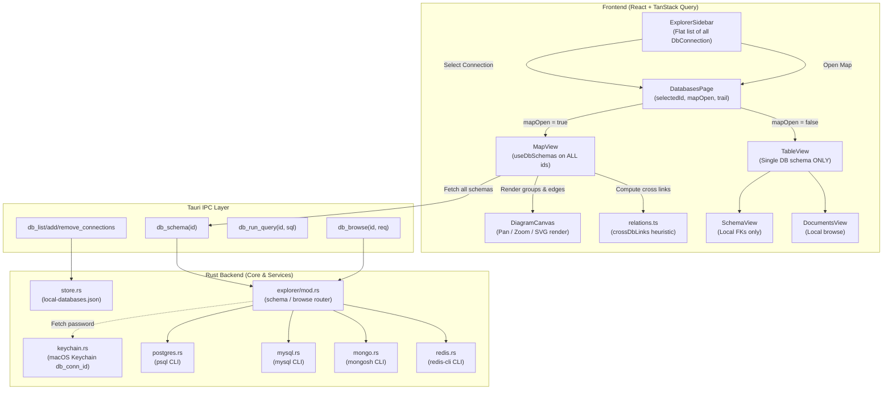
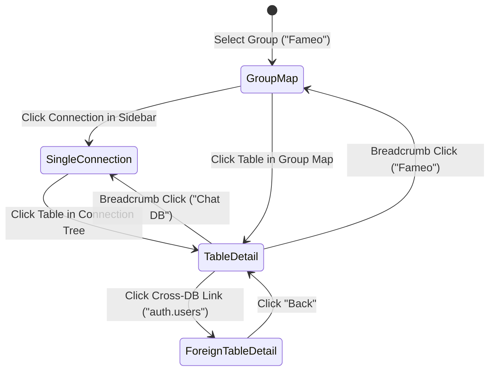
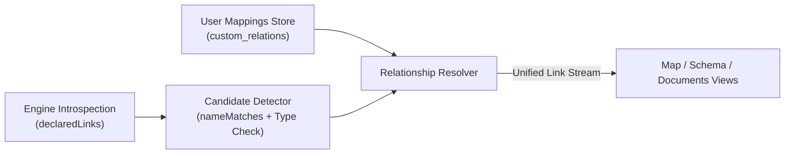

# Stackroost Database Explorer — Comprehensive Architecture & Feature Audit

> **Verification addendum (2026-10-26, branch `fix/servers-feature`).** Every claim below was re-checked
> against the working tree. Most hold. Corrections are marked inline with **[Verified]**, **[Corrected]**
> or **[New]**. Summary:
>
> | Claim                                                                          | Verdict                                                                                                                                                                                                                                                                                                                  |
> | :----------------------------------------------------------------------------- | :----------------------------------------------------------------------------------------------------------------------------------------------------------------------------------------------------------------------------------------------------------------------------------------------------------------------- |
> | Flat store, no groups, no `db_update_connection`, timestamp IDs (ISS-03/05/09) | **Confirmed** — `store.rs`, `commands/databases.rs`                                                                                                                                                                                                                                                                      |
> | `crossDbLinks` drops >1 hit and skips local homonyms (ISS-01)                  | **Confirmed** — `relations.ts` `if (hits.length !== 1) continue` and `a.schema.tables.some(...)`                                                                                                                                                                                                                         |
> | Detail views get only the active DB's links (ISS-02)                           | **Confirmed** — `DatabasesPage.tsx` passes `linksOf(schema)` to `TableView`                                                                                                                                                                                                                                              |
> | `DocumentCard` jump "crashes or fails" on an external target                   | **Corrected** — it cannot crash: cross-DB links never reach `DocumentCard`, so no external jump button is rendered at all. The defect is _missing_ navigation, not a crash.                                                                                                                                              |
> | `useDbSchemas` is unbounded (ISS-04)                                           | **Confirmed**, but the fix belongs in **Rust** (see ISS-04)                                                                                                                                                                                                                                                              |
> | `crossDbLinks` re-runs on every pan/zoom/search keystroke (ISS-06)             | **Corrected — not reproducible.** Pan/zoom/hover/find state lives in `DiagramCanvas` (`useState` for `view`, `hover`, `find`), so `MapView` does not re-render on those events, and the React Compiler (`vite.config.ts`) auto-memoizes. Downgraded to _Info_.                                                           |
> | Stale schema after removal (ISS-08)                                            | **Confirmed, but scenario overstated** — see ISS-08                                                                                                                                                                                                                                                                      |
> | Postgres/MySQL/Mongo/Redis adapters read-only, passwords via env               | **Confirmed** (`PGOPTIONS`/`MYSQL_PWD`/`REDISCLI_AUTH`/`STACKROOST_MONGO_*`)                                                                                                                                                                                                                                             |
> | "0 tests for database UI"                                                      | **Confirmed, with context** — Vitest runs in a **node** env (no jsdom) and `@testing-library/react` is **not installed**; component tests need a dependency decision. Also: `store.rs` has **no** `#[cfg(test)]` module, and `contracts.test.ts` covers postgres/mysql/browse only — **no Mongo/Redis contract golden**. |
>
> **Issues the original audit missed** — see ISS-10 … ISS-14 at the end of section E.

---

## A. Executive Summary

### 1. Current Maturity Stage

The **Stackroost Database Explorer** is currently at an **Advanced Prototype / Single-Database Inspector** stage with an experimental multi-database visual canvas. It provides deep single-database schema introspection, tabular/document data browsing, SQL/command execution, and local APFS snapshot management across four database engines (**PostgreSQL, MySQL, MongoDB, and Redis**).

However, as a **multi-database microservice platform** (e.g., a multi-service ecosystem like Fameo with 5+ databases), it is **architecturally unready for production**.

### 2. What Is Fully Implemented

- **Multi-Engine Single Database Introspection**: Read-only schema and catalog queries via CLI adapters ([postgres.rs](file:///Users/devarpit/Desktop/Stackroost/src-tauri/src/services/databases/explorer/postgres.rs), [mysql.rs](file:///Users/devarpit/Desktop/Stackroost/src-tauri/src/services/databases/explorer/mysql.rs), [mongo.rs](file:///Users/devarpit/Desktop/Stackroost/src-tauri/src/services/databases/explorer/mongo.rs), [redis.rs](file:///Users/devarpit/Desktop/Stackroost/src-tauri/src/services/databases/explorer/redis.rs)).
- **Credential Storage**: Passwords are saved in the macOS Keychain (`db_conn_{id}`) and passed via process environment variables rather than command-line arguments to prevent `ps` snooping.
- **Single-Database Visualization**: SVG-based ER diagrams with interactive zoom, pan, search, and export to SVG/PNG/Mermaid.
- **Read-Only Data Browser**: Compass-style document/table browsing with filter builder, pagination, and sorting.
- **Unified Visual Canvas**: Multi-database map ([MapView.tsx](file:///Users/devarpit/Desktop/Stackroost/src/features/databases/components/MapView/MapView.tsx)) that boxes connected databases and computes heuristic name-based cross-database links.

### 3. What Is Partially Implemented

- **Cross-Database Relationships**: Generated strictly via client-side regex heuristics (`crossDbLinks` in [relations.ts](file:///Users/devarpit/Desktop/Stackroost/src/features/databases/utils/relations.ts#L107-L144)). If more than one database has a matching table name (e.g., two services have a `users` table), the relationship is **silently discarded**.
- **Cross-Database Navigation**: Clicking a table node from the unified map switches the active connection to that table, but once inside `TableView`, **all cross-database links vanish**. The detail views only know about local tables within that single database.
- **Connection Lifecycle**: Connections can be added and removed, but cannot be edited.

### 4. What Is Completely Missing

- **Workspaces & Groups**: Connections exist only in a single flat list. There is no concept of a logical group (e.g., "Fameo", "EduSphere"), no group-scoped maps, no group-scoped permissions, and no group-aware connection moving.
- **User-Confirmed / Configured Cross-Database Mappings**: No mechanism to define, confirm, or persist logical references (e.g., `chat_db.messages.user_id` $\rightarrow$ `auth_db.users.id`).
- **Connection Health & State Machine**: No passive ping, connection state indicators (`connected`, `disconnected`, `connecting`, `failed`), or connection retry mechanisms without executing a full schema introspection.
- **Concurrency & Throttling Limits**: Schema loading across all connections is unbounded; opening the map on 20 connections concurrently spawns 20 independent CLI processes.

### 5. The Three Most Critical Technical Risks

1. **Silent Relationship Omission & False Negatives**: When multiple candidate databases share a table name (very common in microservices with auth, users, or audit stores), `crossDbLinks` silently drops the relation (`if (hits.length !== 1) continue`). Engineers relying on the diagram will receive false certainty that no reference exists.
2. **Context Amnesia in Detail Views**: `TableView`, `SchemaView`, and `DocumentCard` drop all cross-database metadata. A user inspecting a `messages` table cannot see or navigate to the referenced `users` table in another database.
3. **Unbounded CLI Process Spawning & Resource Exhaustion**: Calling `useDbSchemas` concurrently on all saved connections spawns unthrottled external processes (`psql`, `mongosh`, etc.) through Tauri's `spawn_blocking` pool, risking database connection spikes, system memory exhaustion, or timeouts.

### 6. Production Readiness Verdict

**Not Production Ready for Multi-Database / Microservice Workspaces.** It is reliable as a local single-database administrative viewer, but unsuitable for managing interconnected microservices until group scoping, verified relationship modeling, and cross-database navigation are established.

---

## B. Evidence-Based Implementation Inventory

| Capability                                        |        Status         | Evidence (File & Lines)                                                                                                                                                                                                                                       | Defect or Limitation                                                                                                                                                                                              | Required Action                                                                                                                                                                    |
| :------------------------------------------------ | :-------------------: | :------------------------------------------------------------------------------------------------------------------------------------------------------------------------------------------------------------------------------------------------------------ | :---------------------------------------------------------------------------------------------------------------------------------------------------------------------------------------------------------------- | :--------------------------------------------------------------------------------------------------------------------------------------------------------------------------------- |
| **Connection Storage**                            | Verified Implemented  | [store.rs:5-34](file:///Users/devarpit/Desktop/Stackroost/src-tauri/src/services/databases/store.rs#L5-L34)                                                                                                                                                   | Flat `Vec<DbConnection>` stored in `local-databases.json` via `core::store` (atomic, `{version,data}` envelope, corrupt-file backup). No `group_id` or workspace field. Timestamp ID collision risk on rapid add. | Add `groupId` with `#[serde(default)]`; for IDs reuse the existing `/dev/urandom` hex pattern (`database/remote_store.rs` `new_host_id`) — **no `uuid` crate is in `Cargo.toml`**. |
| **Connection Keychain**                           | Verified Implemented  | [commands/databases.rs:55, 95, 183](file:///Users/devarpit/Desktop/Stackroost/src-tauri/src/commands/databases.rs#L55)                                                                                                                                        | Stored as `db_conn_{id}` in macOS Keychain. Passwords stripped from JSON store.                                                                                                                                   | Retain; add keychain cleanup on group purge.                                                                                                                                       |
| **Connection Editing**                            |      **Missing**      | [commands/databases.rs:58-124](file:///Users/devarpit/Desktop/Stackroost/src-tauri/src/commands/databases.rs#L58-L124)                                                                                                                                        | No `db_update_connection` exists. Editing requires deleting and re-creating (loss of tunnel/keychain sync).                                                                                                       | Implement `db_update_connection` command and edit dialog.                                                                                                                          |
| **Workspace / Grouping**                          |      **Missing**      | [ExplorerSidebar.tsx:127-173](file:///Users/devarpit/Desktop/Stackroost/src/features/databases/components/ExplorerSidebar/ExplorerSidebar.tsx#L127-L173)                                                                                                      | Connections rendered as an unorganized flat list. No groups, folders, or workspace filters.                                                                                                                       | Implement `DbGroup` data structure, group CRUD, and sidebar accordion hierarchy.                                                                                                   |
| **Postgres Adapter**                              | Verified Implemented  | [postgres.rs:15-68](file:///Users/devarpit/Desktop/Stackroost/src-tauri/src/services/databases/explorer/postgres.rs#L15-L68)                                                                                                                                  | Introspects catalogs via `psql` CLI in 1 query. Read-only enforced via session variables.                                                                                                                         | Safe, verified.                                                                                                                                                                    |
| **MySQL Adapter**                                 | Verified Implemented  | [mysql.rs:17-38](file:///Users/devarpit/Desktop/Stackroost/src-tauri/src/services/databases/explorer/mysql.rs#L17-L38)                                                                                                                                        | Introspects `information_schema` via `mysql` CLI batch JSON format. Read-only session.                                                                                                                            | Safe, verified.                                                                                                                                                                    |
| **MongoDB Adapter**                               | Verified Implemented  | [mongo.rs:14-68](file:///Users/devarpit/Desktop/Stackroost/src-tauri/src/services/databases/explorer/mongo.rs#L14-L68)                                                                                                                                        | Samples 200 documents via `mongosh` CLI. `relations` always empty. Passwords in env vars.                                                                                                                         | Safe, but schema is probabilistic. Document this in UI.                                                                                                                            |
| **Redis Adapter**                                 | Verified Implemented  | [redis.rs:16-33](file:///Users/devarpit/Desktop/Stackroost/src-tauri/src/services/databases/explorer/redis.rs#L16-L33)                                                                                                                                        | Scans key prefixes (max 20,000 keys) via `redis-cli` and Lua script. No relations.                                                                                                                                | Safe, verified.                                                                                                                                                                    |
| **All-Databases Map**                             | Partially Implemented | [MapView.tsx:20-95](file:///Users/devarpit/Desktop/Stackroost/src/features/databases/components/MapView/MapView.tsx#L20-L95)                                                                                                                                  | Shows all saved connections together. Unbounded schema fetches (`useDbSchemas`). No group filtering.                                                                                                              | Scope map to selected Group. Bound fetch concurrency.                                                                                                                              |
| **Cross-DB Link Detection**                       |     **Defective**     | [relations.ts:110-144](file:///Users/devarpit/Desktop/Stackroost/src/features/databases/utils/relations.ts#L110-L144)                                                                                                                                         | Drops link if >1 candidate database matches (`hits.length !== 1`). Ignores data types. Skips if local DB has any homonym table.                                                                                   | Support ambiguous candidates; report candidate matches; allow explicit user confirmation.                                                                                          |
| **Cross-DB Navigation (Map $\rightarrow$ Table)** | Verified Implemented  | [MapView.tsx:56-59](file:///Users/devarpit/Desktop/Stackroost/src/features/databases/components/MapView/MapView.tsx#L56-L59), [DatabasesPage.tsx:142-146](file:///Users/devarpit/Desktop/Stackroost/src/features/databases/pages/DatabasesPage.tsx#L142-L146) | Switches active database and opens table in `TableView`.                                                                                                                                                          | Verified working.                                                                                                                                                                  |
| **Cross-DB Navigation (Table Detail)**            |      **Missing**      | [DatabasesPage.tsx:63, 233-243](file:///Users/devarpit/Desktop/Stackroost/src/features/databases/pages/DatabasesPage.tsx#L63)                                                                                                                                 | `TableView` only receives `linksOf(schema)` for the single active database. Cross-DB links omitted.                                                                                                               | Inject group-level cross-DB links into `TableView`, `SchemaView`, and `DocumentCard`.                                                                                              |
| **Row Jump Across Databases**                     |      **Missing**      | [DocumentCard.tsx:185-198](file:///Users/devarpit/Desktop/Stackroost/src/features/databases/components/DocumentCard/DocumentCard.tsx#L185-L198)                                                                                                               | Jump button calls `onOpenTable(key, filter)` without `connectionId`. **[Corrected]** It does not crash: `TableView` only receives the active DB's links, so no cross-DB jump button is ever rendered.             | Update `onOpenTable` signature to accept `(connectionId, tableKey, filter)`.                                                                                                       |
| **Schema Cache Invalidation**                     | Partially Implemented | [useExplorer.ts:19-23](file:///Users/devarpit/Desktop/Stackroost/src/features/databases/api/useExplorer.ts#L19-L23), [useDatabases.ts:58-61](file:///Users/devarpit/Desktop/Stackroost/src/features/databases/api/useDatabases.ts#L58-L61)                    | 5-minute stale time. On connection removal, cached schema **and browse pages** are not evicted from React Query.                                                                                                  | Explicitly remove `dbKeys.schema(id)` and `['databases','browse',id]` on delete.                                                                                                   |
| **Connection Health Check**                       |      **Missing**      | [ExplorerSidebar.tsx:148-163](file:///Users/devarpit/Desktop/Stackroost/src/features/databases/components/ExplorerSidebar/ExplorerSidebar.tsx#L148-L163)                                                                                                      | Only displays driver badge and PROD tag. No ping or health status without running full schema scan.                                                                                                               | Add lightweight ping command (`SELECT 1` / `PING`) and status dot indicator.                                                                                                       |
| **Component Test Coverage**                       |      **Missing**      | [src/features/databases/](file:///Users/devarpit/Desktop/Stackroost/src/features/databases)                                                                                                                                                                   | 0 tests for `DatabasesPage`, `MapView`, `TableView`, `SchemaView`, `ExplorerSidebar`.                                                                                                                             | Add component tests covering selection, navigation, and error boundaries.                                                                                                          |

---

## C. Current Architecture



### Architectural Assessment

1. **Coupling & Leaks**: The frontend `MapView` is doing heavy graph layout calculation (`buildMap`), layered shelf positioning, and cross-database relationship discovery directly in the React render pass.
2. **Component Isolation**: `TableView` and `MapView` are completely decoupled from each other's relationship context. `MapView` knows about all databases; `TableView` only knows about the single selected database.
3. **Engine Abstraction**: The Rust backend uses an engine-neutral contract (`DbSchema`, `TableInfo`, `ColumnInfo`, `Relation`), but all drivers are executed as external child processes via command line. There are no persistent database connection pools.

---

## D. Current Data Model and Proposed Group Model

### 1. Existing Data Model

#### Backend Persistence (`local-databases.json` via [store.rs](file:///Users/devarpit/Desktop/Stackroost/src-tauri/src/services/databases/store.rs#L7-L34))

```rust
pub struct DbConnection {
    pub id: String,              // e.g. "db_1729876543210"
    pub name: String,            // e.g. "Main Database"
    pub driver: String,          // "postgres" | "mysql" | "mongo" | "redis"
    pub host: String,            // "127.0.0.1"
    pub port: u16,               // 5432
    pub user: Option<String>,
    pub database: Option<String>,
    pub tunnel_id: Option<String>,
    pub allow_writes: bool,
    pub env: String,             // "dev" | "staging" | "prod"
    pub data_dir: Option<String>,
}

pub struct DbStore {
    pub connections: Vec<DbConnection>,
}
```

### 2. Proposed Group-Based Data Model

To support microservice workspaces (e.g., Fameo, EduSphere) without breaking existing user installations, we propose the following minimum viable data model:

```rust
// Persistent Group definition
#[derive(Debug, Clone, Serialize, Deserialize)]
#[serde(rename_all = "camelCase")]
pub struct DbGroup {
    pub id: String,                  // UUIDv4 (e.g. "grp_fameo_4a1b")
    pub name: String,                // "Fameo"
    pub description: Option<String>, // "Microservice ecosystem"
    pub color: Option<String>,       // Optional UI accent tag
    pub created_at: u64,
    pub updated_at: u64,
}

// Updated DbConnection
#[derive(Debug, Clone, Serialize, Deserialize)]
#[serde(rename_all = "camelCase")]
pub struct DbConnection {
    pub id: String,                  // UUIDv4
    pub group_id: Option<String>,    // None = "Ungrouped" / "Default"
    pub name: String,
    pub driver: String,
    pub host: String,
    pub port: u16,
    pub user: Option<String>,
    pub database: Option<String>,
    pub tunnel_id: Option<String>,
    pub allow_writes: bool,
    pub env: String,
    pub data_dir: Option<String>,
}

// Explicit Application-Level Cross-Database Mapping
#[derive(Debug, Clone, Serialize, Deserialize, PartialEq)]
#[serde(rename_all = "camelCase")]
pub struct DbCrossRelation {
    pub id: String,                  // UUIDv4
    pub group_id: String,            // Scoped strictly to the group
    pub name: String,                // "messages.user_id -> users.id"
    pub from_connection_id: String,  // Chat DB connection ID
    pub from_schema: String,         // "public"
    pub from_table: String,          // "messages"
    pub from_column: String,         // "user_id"
    pub to_connection_id: String,    // Auth DB connection ID
    pub to_schema: String,           // "public"
    pub to_table: String,            // "users"
    pub to_column: String,           // "id"
    pub status: RelationStatus,      // Confirmed | Inferred | Rejected
    pub notes: Option<String>,
}

#[derive(Debug, Clone, Serialize, Deserialize, PartialEq)]
#[serde(rename_all = "camelCase")]
pub enum RelationStatus {
    Confirmed, // Explicitly saved by user
    Inferred,  // Automatically suggested by heuristic engine
    Rejected,  // User explicitly dismissed this candidate
}

// Root Store
#[derive(Debug, Default, Clone, Serialize, Deserialize)]
#[serde(rename_all = "camelCase")]
pub struct DbStore {
    #[serde(default)]
    pub groups: Vec<DbGroup>,
    pub connections: Vec<DbConnection>,
    #[serde(default)]
    pub custom_relations: Vec<DbCrossRelation>,
}
```

### 3. Backwards-Compatible Migration Strategy

- When `DbStore::load` parses an existing `local-databases.json` without `groups` or `custom_relations`, Serde defaults both to empty `Vec::new()`.
- Connections with `group_id: None` are displayed in the UI under an **"(Ungrouped)"** virtual bucket.
- The user can drag or select "Move to Group $\rightarrow$ Create Fameo" to assign connections to groups seamlessly.

---

## E. Issue Register

### ISS-01 [Closed in Phase 3]: Silent Dropping of Inferred Relationships on Multiple Targets

- **Severity**: **High**
- **Status**: **CLOSED** (Phase 3)
- Refactored `crossDbLinks` in `relations.ts` to identify multi-target candidate ties and preserve them with `status: 'ambiguous'` rather than silently dropping them.
- Implemented `AmbiguousRelationsDialog` allowing users to inspect ambiguous candidates, confirm the intended target table/column, or reject candidate false-positives.
- Persisted candidate rejections via `DbRejectedCandidate` in `store.rs` and Tauri commands `db_reject_candidate` / `db_unreject_candidate`.
- Displayed ambiguous relationship counts and visually distinct dashed warning edges in SVG diagrams with ARIA labels and tooltip titles.

### ISS-02 [Closed in Phase 4]: Cross-Database Links Omitted from Detail Views (`TableView`, `SchemaView`, `DocumentCard`)

- **Severity**: **High**
- **Status**: **CLOSED** (Phase 4)
- Lifted cross-database relationship management to `useGroupRelations` hook and unified `linksForTable(connectionId, tableKey)`.
- Extended `OpenTable` navigation contract to accept `(connectionId, tableKey, filter?)` and implemented pure `navigationReducer` with deterministic back/history trail and breadcrumbs (`Group > Connection > Table`).
- Integrated cross-database relationships into `SchemaView` (external target/source connection badges, provenance tags, and click-to-open actions).
- Integrated cross-database jump buttons into `DocumentCard` with type-incompatibility and stale-target jump guards.
- Added cross-database microservice relationships grid to `TableView` Relations tab, grouped by target connection.

### ISS-03 [Closed in Phase 1]: Lack of Group/Workspace Scoping in Connection Management

- **Severity**: **Medium**
- **Status**: **CLOSED** (Phase 1)
- Implemented `DbGroup` data structure and persistence in `store.rs`.
- Added commands `db_list_groups`, `db_create_group`, `db_update_group`, `db_delete_group`, and `db_move_connection`.
- Added Group accordion, group-scoped map views, and ungrouped bucket handling in `ExplorerSidebar.tsx` and `DatabasesPage.tsx`.

### ISS-04: Unbounded Parallel Process Execution during Schema Introspection

- **Severity**: **Medium**
- **Location**: [useExplorer.ts:27-38](file:///Users/devarpit/Desktop/Stackroost/src/features/databases/api/useExplorer.ts#L27-L38), [MapView.tsx:23](file:///Users/devarpit/Desktop/Stackroost/src/features/databases/components/MapView/MapView.tsx#L23)
- **Reproduction Scenario**:
  Open MapView when 10+ databases are connected.
- **Actual Impact**:
  `useDbSchemas` executes `useQueries` with all IDs at once, launching 10+ concurrent child processes via Tauri `blocking`. On systems with limited threads or slow remote connections, this causes UI lag, CLI process contention, and potential timeouts.
- **Recommended Correction**:
  **[Corrected]** Bound it in **Rust**, not with `p-limit`: `commands::blocking` is `tauri::async_runtime::spawn_blocking` (a large pool), and a JS-side limiter would not bound other callers (sidebar `useDbSchema`, refresh). Use one counting semaphore around `explorer::schema` inside `db_schema` (max 3). No new dependency is needed.
- **Dependencies**: None.

### ISS-05 [Closed in Phase 1]: Missing Connection Edit Operation

- **Severity**: **Medium**
- **Status**: **CLOSED** (Phase 1)
- Added `db_update_connection` backend command with mutation gating, re-applying production read-only enforcement, updating configuration while safely preserving or updating Keychain passwords.
- Added `EditConnectionDialog` component allowing full editing of connection configuration without destroying the Keychain secret.

### ISS-06: Quadratic In-Render Calculation of `crossDbLinks`

- **Severity**: ~~Low / Medium~~ **Info — [Corrected]**
- **Verification**: Not reproducible as described. `view`/`hover`/`find` state is local to `DiagramCanvas.tsx:56-58`, so panning, zooming, hovering and typing in "Find a table" re-render only the canvas, not `MapView`. The React Compiler is enabled and CLAUDE.md forbids hand-adding `useMemo` for memoization alone. `crossDbLinks` re-runs only when schema results or the "Links between databases" toggle change. Re-assess only with a measured profile on a large group.
- **Location**: [MapView.tsx:37-39](file:///Users/devarpit/Desktop/Stackroost/src/features/databases/components/MapView/MapView.tsx#L37-L39)
- **Reproduction Scenario**:
  In a group with 8 databases, pan or zoom the diagram canvas or type into the "Find a table" search bar.
- **Actual Impact**:
  `crossDbLinks` runs synchronously in the component render body on every re-render (such as zoom tick or keystroke), re-running regex checks on thousands of table/column pairs without `useMemo`.
- **Recommended Correction**:
  ~~Wrap `crossDbLinks` in `useMemo`.~~ No change needed; if the Phase-3 resolver becomes expensive, compute it once in a shared hook and measure.
- **Dependencies**: None.

### ISS-07 [Closed in Phase 3]: Type-Incompatible Inferred Links (e.g. UUID vs Integer vs Mongo ObjectId)

- **Severity**: **Medium**
- **Status**: **CLOSED** (Phase 3)
- Implemented `classifyTypeCompatibility(sourceType, targetType)` in `relations.ts`.
- Detected and flagged incompatible column type pairs (such as `integer` vs `ObjectId`, `uuid` vs `integer`, `boolean` vs `varchar`), suppressing invalid heuristic cross-database edges from diagram rendering.
- Recorded explanatory reasons (`compatibilityReason`) on links for auditability and diagnostic clarity.

### ISS-08 [Closed in Phase 1]: Stale React Query Schema Cache on Connection Removal

- **Severity**: **Low**
- **Status**: **CLOSED** (Phase 1)
- `useRemoveDbConnection` and `useUpdateDbConnection` now actively evict `['databases', 'schema', id]` and `['databases', 'browse', id]` cache entries from React Query upon connection deletion or update.

### ISS-09 [Closed in Phase 1]: Timestamp-Based Connection ID Collision Risk

- **Severity**: **Low**
- **Status**: **CLOSED** (Phase 1)
- Replaced timestamp-only ID generator with collision-resistant `new_connection_id()` and `new_group_id()` using `/dev/urandom` entropy buffer.
- Verified with unit tests producing 100 consecutive collision-free IDs for both connections and groups.

### ISS-10 [Closed in Phase 1]: `db_set_password` is an ungated, unvalidated, unused command

- **Severity**: **Medium (security)**
- **Status**: **CLOSED** (Phase 1)
- Removed `db_set_password` completely from `commands/databases.rs` and `src-tauri/src/lib.rs`.
- Keychain updates now strictly reside within the gated and validated `db_update_connection` command.

### ISS-11 [Closed in Phase 1]: Keychain write failure on add is silently ignored

- **Severity**: **Medium**
- **Status**: **CLOSED** (Phase 1)
- In `db_add_connection`, `keychain::set_password` failures are now propagated immediately via `AppError::Io`, aborting connection creation and leaving the store consistent.

### ISS-12 [Closed in Phase 1]: `driver` and `env` are not validated on the Rust boundary

- **Severity**: **Low**
- **Status**: **CLOSED** (Phase 1)
- Added `validate_driver` and `validate_env` helpers in `commands/databases.rs`, enforcing driver support (`postgres`, `mysql`, `mongo`, `mongodb`, `redis`) and known environments on all add/update boundaries.

### ISS-13 [New]: DB connections never call `check_outbound_allowed`

- **Severity**: **Low (policy consistency)**
- **Location**: `core/net.rs` declares a `db_hosts` destination, but `db_schema`, `db_browse` and `db_run_query` never call `check_outbound_allowed` (cloud, updater, domains and AI do).
- **Impact**: Turning off the declared destination wouldn't stop DB traffic. Any new `db_ping`/health check (Phase 4/5) must call the check, and the existing commands should too.

### ISS-14 [Closed in Phase 0]: Missing test coverage at the data boundary

- **Severity**: **Low**
- **Status**: **CLOSED** (Phase 0)
- `store.rs` unit tests added (`empty_store_loads_default_and_saves`, `store_add_updates_existing_and_remove`, `store_deserializes_legacy_json_without_optional_fields`, `new_connection_id_starts_with_prefix`).
- `contracts.test.ts` and `explorer_contracts_golden` updated with Mongo and Redis schema contract verification.

---

## F. Target User Experience

### 1. Sidebar Hierarchy & Interaction

- **Group Accordion**:
  - Top level displays Groups: `▼ Fameo (5)`, `▶ EduSphere (3)`, `▶ (Ungrouped) (1)`.
  - Header actions: `+ Add Group`, `+ Add Connection`.
  - Hovering a group displays: `[Map Icon]` (opens group unified map), `[Edit Group]`, `[Delete Group]`.
- **Connection Items**:
  - Each item displays: Engine badge (`PG`, `MY`, `MG`, `RD`), connection name, host/database, environment badge (`PROD`), and a **health indicator dot** (green = reachable, red = error, gray = idle).
  - Context menu on connection: `Edit Connection`, `Move to Group...`, `Test Connection`, `Duplicate`, `Delete`.

### 2. Selection Scopes



- **A. Group Selection (`Fameo`)**:
  - Renders the `MapView` restricted strictly to the 5 databases of the `Fameo` group.
  - Generates cross-database links only between `Fameo` databases.
  - Toolbar includes a "Relations Filter": `All`, `Confirmed Only`, `Inferred (Guessed)`.
- **B. Single-Connection Selection (`Fameo → Chat Service`)**:
  - Displays the single-database view (Overview, Diagram, SQL/Shell, Snapshots).
  - The diagram displays only the `Chat Service` tables.
- **C. Table Selection (`messages`)**:
  - Displays `TableView` with tabs: `Documents`, `Schema`, `Indexes`, `Relations`.
  - **Schema Tab**: Displays local foreign keys _and_ cross-database relationships in the "Points to" and "Referenced by" sections, with an explicit badge indicating external database target (e.g., `↗ auth_service.users.id [Inferred]`).
  - **Documents Tab**: Foreign key jump buttons work across databases. Clicking `user_id → auth_service.users` switches active context to `auth_service`, opens `users`, and filters by `id = <value>`.
  - **Breadcrumbs**: Top header shows: `Fameo` $\rightarrow$ `Chat Service` $\rightarrow$ `messages`. Clicking `Fameo` returns to the group map without losing state.

---

## G. Proposed Architecture and Technical Design

### 1. Minimal Sound Design Principles

- **No Unnecessary Abstractions**: Do not introduce heavyweight ORMs or embedded graph databases.
- **Leverage Existing Primitives**: Retain the existing SVG renderer (`DiagramCanvas`), catalog queries (`postgres.rs`, etc.), and Keychain integration.
- **Explicit Domain Model for Relationships**: Separate database-level declared constraints from application-level cross-database references.

### 2. Cross-Database Relationship Engine



#### Resolution Algorithm

1. **Declared Links**: Extracted from database foreign key constraints (intra-database only).
2. **Custom / Confirmed Links**: User-defined links in `custom_relations` override all guesses.
3. **Rejected Links**: If a candidate link was dismissed by the user, suppress it permanently.
4. **Candidate Inferences**:
   - Parse column suffix (`_id`, `Id`, `_uuid`, `_key`).
   - Match candidate table name in external databases belonging to the **same group**.
   - Check data type compatibility (e.g., Integer $\leftrightarrow$ Integer, UUID $\leftrightarrow$ UUID, String $\leftrightarrow$ ObjectId).
   - If exactly 1 compatible candidate: generate `Inferred` link.
   - If multiple candidates: generate `Ambiguous` candidate and display candidate picker.

### 3. Navigation & State Contract

Replace the current flat state in `DatabasesPage.tsx` with a structured navigation context:

```ts
interface DatabaseNavState {
  activeGroupId: string | null;
  activeConnectionId: string | null;
  trail: Array<{
    connectionId: string;
    tableKey: string;
    filter?: Filter;
  }>;
  viewMode: 'group-map' | 'connection' | 'table';
}
```

This enables seamless back-and-forth navigation across different databases without losing group context.

---

## H. Phased Implementation Plan

```mermaid
gantt
    title Implementation Phases
    dateFormat  X
    axisFormat %d
    section Phases
    Phase 0: Architectural Foundations & Test Harness    :0, 1
    Phase 1: Group-Based Connection Management          :1, 2
    Phase 2: Trustworthy Cross-DB Detection Engine       :2, 3
    Phase 3: Cross-Database Table & Row Navigation       :3, 4
    Phase 4: Scalability, Concurrency & Resilience       :4, 5
    Phase 5: Final Polish, Security & Integration Tests  :5, 6
```



### Phase 0: Architectural Foundations & Test Harness

- **Objectives**: Establish automated contract and integration tests for database commands before refactoring.
- **Files**:
  - `src-tauri/src/services/databases/store.rs`
  - `src/features/databases/api/contracts.test.ts`
  - New: `src/features/databases/test/databaseMocks.ts`
- **Prerequisites**: Current test suite passing (verified clean baseline).
- **Proposed Changes**:
  - Create reproducible multi-database schema fixtures (e.g., 5-database microservice ecosystem fixture representing Fameo: Postgres auth, Mongo chat, etc.).
  - Add integration tests for store serialization/deserialization.
- **Risks**: None (test-only additions).
- **Acceptance Criteria**: Test harness executes in Vitest and Cargo test within 3 seconds.

---

### Phase 1: Group-Based Connection Management

- **Objectives**: Enable users to create, rename, delete groups and assign connections to them.
- **Files**:
  - `src-tauri/src/services/databases/store.rs`
  - `src-tauri/src/commands/databases.rs`
  - `src/features/databases/api/databases.schema.ts`
  - `src/features/databases/api/useDatabases.ts`
  - `src/features/databases/components/ExplorerSidebar/ExplorerSidebar.tsx`
  - `src/features/databases/components/AddConnectionDialog/AddConnectionDialog.tsx`
- **Prerequisites**: Phase 0.
- **Proposed Changes**:
  - Add `DbGroup` to `DbStore` in Rust with safe serde defaults.
  - Implement commands: `db_list_groups`, `db_create_group`, `db_rename_group`, `db_delete_group`, `db_update_connection`.
  - **[New — repo contract]** Each command touches four places: `commands/databases.rs`, `lib.rs` `generate_handler!`, `CMD` in `src/shared/tauri/commands.ts`, and a zod schema in `features/databases/api/*.schema.ts`. Each mutating command needs a `MutationGuard`; deleting a group _with_ its connections needs a destructive native `mutation(...)` (NSAlert) — never `window.confirm`. The `db_` prefix is already mapped to the `databases` module in `core/capabilities.rs`.
  - Update `AddConnectionDialog` to include group selection dropdown.
  - Update `ExplorerSidebar` to display accordion group structure.
- **Migration Risk**: Existing `local-databases.json` without groups must deserialize cleanly with unassigned connections mapped to `(Ungrouped)`.
- **Acceptance Criteria**:
  - Existing connections load without error.
  - Creating group "Fameo" and moving 5 connections into it persists across app restart.
  - Deleting a group prompts whether to keep or remove its connections.

---

### Phase 2: Trustworthy Cross-Database Detection Engine

- **Objectives**: Fix silent dropping of relationships, add data type validation, support ambiguous candidates, and allow user confirmations.
- **Files**:
  - `src/features/databases/utils/relations.ts`
  - `src/features/databases/utils/relations.test.ts`
  - `src-tauri/src/services/databases/store.rs` (custom_relations)
  - `src-tauri/src/commands/databases.rs`
- **Prerequisites**: Phase 1.
- **Proposed Changes**:
  - Refactor `crossDbLinks` to accept group context and respect `custom_relations`.
  - Replace `if (hits.length !== 1) continue` with ambiguity classification.
  - Add type compatibility check (prevent Integer $\leftrightarrow$ ObjectId false positives).
  - Add commands to save and remove confirmed/rejected relation mappings.
- **Acceptance Criteria**:
  - Multiple candidates produce an `Ambiguous` relationship rather than vanishing.
  - Confirmed mappings persist in `local-databases.json`.
  - Unit tests in `relations.test.ts` pass with 100% coverage of multi-target cases.

---

### Phase 3: Cross-Database Table & Row Navigation

- **Objectives**: Integrate cross-database relationships into `TableView`, `SchemaView`, and `DocumentCard`.
- **Files**:
  - `src/features/databases/pages/DatabasesPage.tsx`
  - `src/features/databases/components/TableView/TableView.tsx`
  - `src/features/databases/components/SchemaView/SchemaView.tsx`
  - `src/features/databases/components/DocumentsView/DocumentsView.tsx`
  - `src/features/databases/components/DocumentCard/DocumentCard.tsx`
- **Prerequisites**: Phase 2.
- **Proposed Changes**:
  - Update `onOpenTable` signature to accept `(connectionId, tableKey, filter)`.
  - Pass group-level cross-links into `TableView`, `SchemaView`, and `DocumentCard`.
  - In `DocumentCard`, render external database badges on foreign key jump buttons (e.g. `→ auth.users`).
  - Clicking an external jump button transitions context to destination database and applies filter.
  - Update breadcrumbs to display `Group > Connection > Table` with working back navigation.
- **Acceptance Criteria**:
  - Navigating from `chat.messages` $\rightarrow$ `auth.users` switches connection seamlessly.
  - Clicking "Back" returns to `chat.messages` with previous query and page intact.

---

### Phase 4: Scalability, Concurrency & Resilience

- **Objectives**: Bounded parallel schema loading, fast health checks, and memoized layout.
- **Files**:
  - `src/features/databases/api/useExplorer.ts`
  - `src/features/databases/components/MapView/MapView.tsx`
  - `src-tauri/src/commands/databases.rs`
- **Prerequisites**: Phase 3.
- **Proposed Changes**:
  - Implement lightweight `db_ping` command to check reachability without running full schema introspection.
  - Add concurrency cap (max 3 concurrent schema introspections) **in Rust around `db_schema`** (see ISS-04).
  - ~~Memoize `crossDbLinks` and `buildMap` using `useMemo` in `MapView`.~~ Not needed (ISS-06, React Compiler).
  - Add sidebar connection status indicator dots based on passive ping. **[Corrected]** Any periodic ping must be a job on `services::scheduler` (one thread, 10 s tick, pauses on low battery) — never a new loop thread — and must call `check_outbound_allowed` (ISS-13).
- **Acceptance Criteria**:
  - Opening map on 10 databases does not exceed 3 concurrent CLI processes.
  - Canvas interactions (pan/zoom) operate at 60 FPS without re-computing relations.

---

### Phase 5: Final Polish, Security & Integration Tests

- **Objectives**: Full regression testing, export verification, and security verification.
- **Files**:
  - All database feature files.
- **Prerequisites**: Phases 1–4.
- **Proposed Changes**:
  - Add comprehensive component tests using `@testing-library/react`. **[Corrected]** Not installed, and Vitest runs in a node env. Either approve adding `@testing-library/react` + `jsdom` (a dependency decision), or — preferred by the repo's conventions — extract navigation/relationship logic into pure functions and test those.
  - Verify credential redaction in all error panels and export filenames.
  - Verify APFS snapshot branching functions properly alongside group model.
- **Acceptance Criteria**:
  - 100% of automated tests passing in CI (`cargo test`, `npm test`, `npm run typecheck`, `npm run lint`, clippy `-D warnings`). **[Corrected]** The repo uses **npm**, not pnpm.
  - Zero plain-text passwords in logs, React state, or JSON store files.

---

## I. Measurable Acceptance Criteria

1. **Group and Connection Isolation**:
   - Databases belonging to Group A are never rendered on Group B's map.
   - Heuristic relationships never bridge databases across different groups.
2. **Relationship Accuracy & Ambiguity Handling**:
   - Zero silent drops when multiple matching tables exist across services.
   - Type incompatibilities (e.g., Number vs ObjectId) flagged with visual warning.
3. **Cross-Database Navigation**:
   - 1-click navigation from any foreign key field to the destination table in another database.
   - Back navigation retraces the exact path across database boundaries without resetting state.
4. **Performance & Concurrency**:
   - Peak concurrent CLI processes capped at $\le 3$.
   - Group map pan/zoom maintains 60 FPS on diagrams with $\ge 50$ tables.
5. **Security & Credential Safety**:
   - Passwords stored exclusively in macOS Keychain.
   - Credentials redacted from all error messages and exported diagrams.

---

## J. Prioritized Recommendations

### 1. What Should Be Fixed First

**Phase 1 (Group-Aware Connection Management)** and **Phase 2 (Fixing Silent Relationship Dropping in `relations.ts`)**. Grouping is the fundamental structural requirement for microservices, and fixing `relations.ts` prevents false conclusions regarding database dependencies.

### 2. What Can Safely Wait

- Automatic database schema migration tools.
- Write operations / inline cell editing (the read-only explorer is safe and effective).
- Complex cloud connection wizards (manual host/port/tunnel parameters work reliably).

### 3. Which Current Features Should Be Preserved

- The existing CLI introspection engine ([postgres.rs](file:///Users/devarpit/Desktop/Stackroost/src-tauri/src/services/databases/explorer/postgres.rs), [mysql.rs](file:///Users/devarpit/Desktop/Stackroost/src-tauri/src/services/databases/explorer/mysql.rs), etc.) — it avoids heavy native driver dependencies and runs safely in read-only sessions.
- The SVG diagram canvas ([DiagramCanvas.tsx](file:///Users/devarpit/Desktop/Stackroost/src/features/databases/components/DiagramCanvas/DiagramCanvas.tsx)) and export pipeline.
- Keychain credential separation.

### 4. What Would Be Overengineering

- Rewriting adapters using native Rust async drivers (`sqlx`, `mongodb`, `redis-rs`). Spawning CLI processes is fast, isolated, and leverages system Homebrew installations cleanly.
- Introducing an external graph database or a _new_ state library. **[Corrected]** Redux Toolkit is already in the app for UI/intent state (`shared/state`), and persistence goes through `tauri-plugin-store` / `core::store`, not localStorage. Navigation state can stay local to `DatabasesPage` (or a reducer there); persisted groups/mappings belong in the Rust store.

### 5. Single Next Implementation Phase Recommended for Approval

**Phase 1: Group-Based Connection Management** (Data Model migration in `store.rs`, `db_update_connection` in `commands/databases.rs`, and sidebar group accordion in `ExplorerSidebar.tsx`).

### 6. Evidence Required to Confirm Phase 1 Complete

- Successful execution of `cargo test` and `vitest` covering group persistence and deserialization.
- Clean visual verification of Group creation, connection grouping, and connection editing in the UI.

---

## K. Final Audit Verdict

| Category                              | Score (out of 10) | Evaluation & Evidence                                                                                      |
| :------------------------------------ | :---------------: | :--------------------------------------------------------------------------------------------------------- |
| **Group & Connection Management**     |   **3.0 / 10**    | Flat list only; no groups; no connection editing; timestamp ID collision hazard.                           |
| **Multi-Engine Support**              |   **8.5 / 10**    | Excellent single-database adapters for Postgres, MySQL, Mongo, Redis with read-only enforcement.           |
| **Cross-DB Relationship Correctness** |   **4.0 / 10**    | Brittle regex heuristics; silent drops when multiple targets match; ignores data types.                    |
| **Cross-DB Navigation**               |   **3.5 / 10**    | Map switches database on click, but single-table views lose all cross-database context.                    |
| **Scalability**                       |   **5.0 / 10**    | Quadratic in-render link inference; unthrottled concurrent CLI execution on multi-database map.            |
| **Reliability**                       |   **6.5 / 10**    | Single DB flows are resilient; multi-DB error handling is partial; cache invalidation leaks on delete.     |
| **Security**                          |   **8.5 / 10**    | Keychain credentials; environment variable passing; strict session read-only enforcement.                  |
| **Maintainability**                   |   **7.5 / 10**    | Clean, well-typed code, but navigation state in `DatabasesPage` is beginning to accumulate prop drilling.  |
| **Test Coverage**                     |   **5.0 / 10**    | Excellent unit tests for relations and diagram math; zero component/integration tests for UI flows.        |
| **User Experience**                   |   **6.5 / 10**    | Beautiful single-table browser and diagram canvas, but lacks microservice workspace hierarchy.             |
| **OVERALL READINESS SCORE**           |   **5.8 / 10**    | Solid single-database explorer, but requires architectural grouping and relation repair for microservices. |

---

## 13. Required Final Action

**Recommended Phase for Initial Approval:**
👉 **Phase 1: Group-Based Connection Management**

- **Scope**: Add `DbGroup` to `store.rs`, implement `db_update_connection`, add group management commands, and update `ExplorerSidebar.tsx` with accordion group hierarchy and move-to-group functionality.
- **Risks**: Schema migration of `local-databases.json` (mitigated by Serde default fallback to `(Ungrouped)`).
- **Exit Criteria**: Full persistence of groups and connections across restarts with 100% clean test passes.

_Audit complete. Standing by for user review and approval before proceeding with Phase 1._
